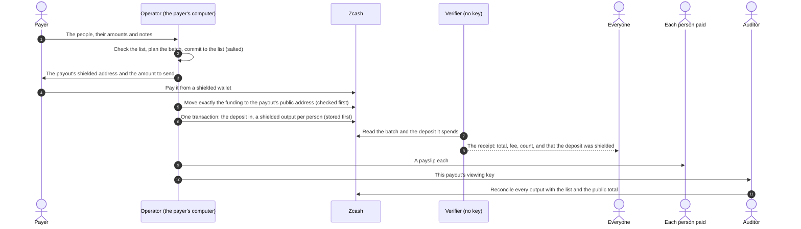
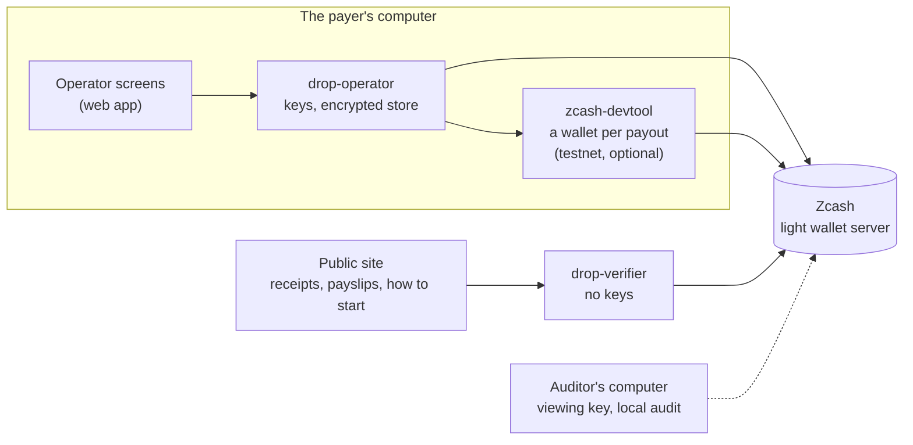

# ZecDrop

**Pay many people. Keep who got what private. Prove the total.** Confidential batch payouts on Zcash.

[Make a payout](#make-a-payout) · [How to test it](docs/JUDGES.md) · [How a payout works](#how-a-payout-works) ·
[Architecture](#architecture) · [Privacy](#privacy) · [Privacy boundary](docs/PRIVACY_BOUNDARY.md) ·
[Security](docs/SECURITY.md) · [Live site](https://zecdrop-site.vercel.app)

One Zcash transaction pays up to 330 people from one deposit, each in a shielded output with a memo of its own. Then each
party sees what they should, and no more: **one payout, four views.** Everyone can check the total; each person paid can
prove their own payout; an auditor you choose can reconcile the whole list; and only the payer's own computer sees every
address and amount.

Built for the [Zecathon](https://thezecathon.com/) **Shielded Payments** track.

> **For judges:** [docs/JUDGES.md](docs/JUDGES.md) has five ways to test ZecDrop, from no install to a real payout of your own
> with one command. The quickest is the [live receipt of a real payout](https://zecdrop-site.vercel.app/r/c-6207fac6674f?network=testnet&tx=af8adf80e3a58378d4ed4852cfbbb035be5dbd4bde65dab732fa3bf95cd64a12&commitment=ca5ccacaaa467610fb8c0e1a36c364429c9ff91f17403a34ea679292fd73803f&declared_total=500000)
> (8 people on Zcash testnet, funded from a shielded wallet), then the same check on your own machine with the key-less
> verifier. Then [what has run](#what-has-run) and the [known limits](#known-limits).

## Contents

- [Highlights](#highlights)
- [Why ZecDrop](#why-zecdrop)
- [How a payout works](#how-a-payout-works)
- [Architecture](#architecture)
- [Privacy](#privacy)
- [What has run](#what-has-run)
- [Make a payout](#make-a-payout)
- [Try it](#try-it)
- [Status and known limits](#status-and-known-limits)
- [Documentation](#documentation)

## Highlights

- **One command on your own computer.** `./zecdrop up` builds ZecDrop, starts it in Docker on testnet and opens it in your
  browser. Your keys and your payout list never leave your computer, and there is no account and no wallet to connect.
- **One transaction, up to 330 people.** One deposit in, one Ironwood output per person, each with its own memo. The network
  publishes the total entering the shielded pool, the fee and the number of outputs; every address and amount stays
  encrypted.
- **One payout, four views.** Everyone checks the total, each person proves their own line, an auditor you choose reconciles
  the list, and only your computer sees everything ([Privacy](#privacy)).
- **A receipt anyone can check, with no key.** A verifier recomputes the receipt from public chain data alone. A test keeps
  every key-decoding and storage crate out of its dependencies, so it can run anywhere, even on a server nobody trusts.
- **Payslips.** A person paid can prove to a landlord or a bank that one output paid them an amount, with no viewing key and
  without revealing anyone else. Anyone can check it against the chain.
- **An auditor's key opens one payout.** Each payout is its own ZIP 32 account, and the receipt carries a salted commitment to
  the payout list, so the auditor checks the list itself, not only the sum.
- **Fund it from a shielded wallet.** On testnet each payout has a shielded address of its own. The payer pays it; ZecDrop
  moves exactly the funding to the public address in a transaction it checks before sending. The payer's wallet never pays a
  public address, and the receipt says the deposit came out of the shielded pool.
- **Crash-safe.** Every transaction is stored before it is broadcast, and after a crash it is sent again from those bytes,
  never built again.
- **Run on public testnet.** [Seven payouts](#what-has-run), each with public transactions: one funded through its shielded
  address with nothing done by hand, and two started with `./zecdrop up` from an empty folder.

## Why ZecDrop

- **A public payout list shows everyone everything.** An airdrop or a grant round on a transparent chain publishes who got how
  much; sorted by amount, it is a list of whom to target.
- **A private wallet hides everything.** Paying each person from a shielded wallet hides the amounts, and the total with them:
  nobody can check that the payout was what it claimed to be.
- **ZecDrop keeps the amounts private and the total accountable.** The shielded pool hides each output, and the protocol itself
  publishes the one number everyone needs: what entered the pool.

## How a payout works

Around one payout: the **payer**, who runs ZecDrop's operator on their own computer; the **people paid**; **everyone** else;
and an **auditor**, if the payer chooses one.

### The idea

1. **One deposit is the public total.** Each payout has a transparent funding address of its own. What arrives there is the
   amount everyone can check.
2. **One transaction pays everyone.** It spends that deposit into one shielded output per person, in the Ironwood pool (since
   NU6.3 no new value may enter Orchard). Zcash publishes the value entering the pool, the fee and the number of outputs;
   each output's address, amount and memo are encrypted.
3. **A commitment to the list.** The receipt carries a salted hash of the payout list. With this payout's viewing key, the
   auditor decrypts every output and checks the list against that hash and against the public total.
4. **A proof per person.** A payslip opens one output: its receiver, its amount and the note's randomness. Anyone can rebuild
   the note's commitment from it and find that commitment in the transaction.
5. **Shielded money in.** Instead of the public address, the payer can pay a shielded address of the payout's own. ZecDrop
   then moves exactly the funding to the public address itself, so the payer's wallet never pays a public address.

### Step by step



The move waits a random 1 to 10 minutes after the payment has confirmed, so that it does not line up in time with the
payment. Before storing or sending any transaction, the operator checks its raw bytes with its own parser: its shape, its fee,
and that it pays exactly what it should. Paying the public address directly still works, from a shielded balance or not; the
funding screen and the receipt say which kind of deposit arrived. The design is in
[ADR 0001](docs/ADR/0001-single-tx-transparent-to-ironwood-batches.md) and [ADR 0006](docs/ADR/0006-shielded-inbox.md).

### If something goes wrong

| What happens | What ZecDrop does |
|---|---|
| The operator stops mid-send | It resumes from its ledger and sends the stored bytes again; a batch is never built twice |
| A broadcast's reply is lost | It asks the node for the transaction before deciding anything |
| A payment to the shielded address falls short | The screen says how much more to send; payments add up |
| More arrives than was asked | What is left can be sent back to a shielded address of the payer's |
| The payout is also paid at its public address | The shielded address is not used, and what it holds can go back |
| A move is not mined before it expires | It is built again only once the wallet has scanned past its expiry; a mined move is final |
| The operator restarts during a deposit | The screen says what the store knows, never the public address alone, so nobody pays twice |
| A payout to one person, or equal amounts | Each amount could be worked out from the total: the planner avoids batches of one, and the review step warns |

## Architecture

The operator runs on the payer's own computer and holds the keys: there is no wallet to connect. The verifier holds no key, so
anyone can run it; the public site uses a hosted one.



| Part | What it does |
|---|---|
| **drop-operator** ([crates/drop-operator](crates/drop-operator)) | Runs on the payer's computer: the screens and a loopback-only API with a per-run token, the encrypted store, funding detection, the batch engine (build, store, send, confirm), payslips, the viewing-key export, the local audit, and each payout's shielded deposit address. |
| **drop-verifier** ([crates/drop-verifier](crates/drop-verifier)) | The key-less receipt and payslip service: it reads the named transactions from a light wallet server and recomputes the receipt. Stateless; one Docker image ([deploy/](deploy)). |
| **The web app** ([web/](web)) | The public site (receipts, payslips, a page for people being paid, and the page that gives the command to run ZecDrop) and the operator's screens, which the operator serves itself. |
| **The launcher** ([zecdrop](zecdrop), [deploy/operator.Dockerfile](deploy/operator.Dockerfile)) | `./zecdrop up` builds the operator's image and runs it in Docker on testnet, published on the computer's loopback address only, with its data in a folder only the person can read. |
| **zcash-devtool** ([scripts/zcash-devtool](scripts/zcash-devtool/README.md)) | Optional, testnet only: one wallet per payout, behind its shielded deposit address. Built from upstream with ZecDrop's own patch, and run as a separate process. |
| **Zcash** | A lightwalletd or Zaino server: `testnet.zec.rocks` on testnet. |

### Code map

| Path | What it is |
|---|---|
| `crates/drop-core` | The payout itself, free of I/O: money, the CSV import, the batch planner, the fee policy, the salted list commitment, and the resumable engine |
| `crates/drop-zcash` | Zcash: the Ironwood batch builder, each payout's keys, payslips, and the shielded deposit address's keys and transaction checks |
| `crates/drop-chain` | The light wallet client (gRPC, generated from the lightwallet protocol definitions) |
| `crates/drop-verify` | Receipt and payslip checks from public chain data alone, with no key |
| `crates/drop-verifier` | The verifier service |
| `crates/drop-operator` | The operator: API, store, engine, funding, payslips, audit, the shielded deposit address |
| `crates/drop-near` | Optional funding from another coin through NEAR Intents |
| `web/` | The site and the operator's screens (React, Tailwind) |
| `openspec/` | The requirements, each with an ID that its tests name |
| `fixtures/` | Public chain data of the real runs, and the operator API's recorded answers |
| `docs/` | The judges' guide, privacy boundary, security model, decisions and runbooks ([Documentation](#documentation)) |
| `scripts/` | The requirement check, the fixture capture and the zcash-devtool build |
| `zecdrop` | The launcher: `./zecdrop up`, `down`, `status`, `logs`, `open`, `update` |
| `deploy/` | The containers (the operator's and the verifier's) and the verifier's server set-up |

## Privacy

### One payout, four views

| Who | What they see | How |
|---|---|---|
| **Everyone** | the total, the fee, how many were paid, and whether the deposit came out of the shielded pool | the receipt link, checked from chain data by a verifier that holds no key |
| **Each person paid** | their own payout, and nobody else's | their payslip, which anyone can check against the chain |
| **An auditor you choose** | the whole list of this payout, reconciled against the public total | this payout's viewing key, which opens no other payout |
| **You, the payer** | every address, amount and note | the operator on your own computer, which holds the keys |

### What the chain shows

| Public | Hidden |
|---|---|
| The funding address and the total, the fee, the transaction ids, the number of outputs | Each person's address, amount and memo |
| Whether the deposit came out of the shielded pool or from transparent funds | The payer's address, when they pay from a shielded balance or through the payout's shielded address |

### Kept out, and tested

- **The verifier cannot hold a key:** its dependencies contain no key-decoding or storage crate
  (`crates/drop-verifier/tests/no_keys.rs`).
- **The receipt names nothing the deposit spent**, only its kind: shielded or transparent (`crates/drop-verify/tests/verify.rs`).
- **A payslip opens its own output and no other**, checked against the real batches as mined
  (`crates/drop-verify/tests/real_batch_payslips.rs`).
- **Nothing of a shielded deposit address reaches the receipt, the logs or the payout's viewing key**
  (`crates/drop-operator/tests/inbox.rs`), and on the real run the auditor's key opened none of its transactions
  ([the fixture](fixtures/testnet-ironwood-batch-8-inbox/README.md)).
- **The screens claim nothing the privacy boundary does not:** their wording is checked against a list of overclaims
  (`web/src/test/banned-phrases.ts`).

What ZecDrop cannot hide (a batch of one, equal amounts, the total and its timing) is in
[PRIVACY_BOUNDARY.md](docs/PRIVACY_BOUNDARY.md).

## What has run

Seven payouts on Zcash public testnet: the first built with the batch builder's test tool, the other six through ZecDrop's
operator. Each transaction is on the chain ([ZecBlock](https://testnet.zecblock.com)); the outputs are shielded. Nothing has
run on mainnet.

| Payout | When | What it showed | Transactions |
|---|---|---|---|
| 3 people, the first batch | 2026-10-08 | The network accepts one deposit into many Ironwood outputs; the deposit was the testnet faucet's, from its shielded wallet | [batch](https://testnet.zecblock.com/tx/50fb88e02e7f4b0f3b3b658f50b09b12ea973d8c3697f8bad4c59e41075ea3e3) |
| 8 people, the whole product path | 2026-10-08 | Create to settled in about 2 minutes; the receipt verified, 8 of 8 payslips, the audit reconciled 8 of 8 | [batch](https://testnet.zecblock.com/tx/6e2359182d1dc77253ebe46aecdecd45d829a5b1baecf2750cb6a3736a877955) |
| 2 people, the first shielded deposit address (by hand) | 2026-10-24 | The move, made by hand through the operator's check, funded a real payout | [move](https://testnet.zecblock.com/tx/543ae84065e8767db1c91eda188bc09e2ec5b692425e7842481fad4b99b95f23), [batch](https://testnet.zecblock.com/tx/0d4301fe8b9bcd4b851dbf91255d88d7e50220fe2b51fb216f15b2d458f34813) |
| 8 people, funded through their payout's shielded address | 2026-10-24 | Nothing done by hand; about 16 minutes from payment to settled. A fresh verifier says *shielded*, no findings; 8 of 8 payslips; the audit reconciled 8 of 8; the auditor's key opened nothing of the shielded address | [move](https://testnet.zecblock.com/tx/6e677bc50c0e17396340d40bbf5464d749c7192c6d19f914a7db5772ad5870f3), [batch](https://testnet.zecblock.com/tx/af8adf80e3a58378d4ed4852cfbbb035be5dbd4bde65dab732fa3bf95cd64a12) |
| 2 people, paid more than asked | 2026-10-24 | The move left 100,000 zat in the shielded address; the send-back gave the payer's shielded wallet exactly 90,000 (the rest was its fee) | [move](https://testnet.zecblock.com/tx/1ddf0b37bba4e30aee121cc60b8a147784e5c9014ce5d64f63b6ad1b76ce2085), [send-back](https://testnet.zecblock.com/tx/2131eae86468c0cb3d1ae0080961c58d17f0756dbebf87b8b552fa73b672c4b8), [batch](https://testnet.zecblock.com/tx/4778eeaa5d071523f0db4bde1f230ec1be834b372950c080bbda0a98cd41737f) |
| 8 people, twice, through `./zecdrop up` from an empty folder | 2026-10-25 | One command built and started the operator in Docker. The second run went through its screens in a browser: the link opened on the payouts; the example list; a deposit from a shielded wallet; sent and settled about 6 minutes after the payment; *Open public receipt* opened the public site, whose verifier says settled, *shielded*, no findings | first: [deposit](https://testnet.zecblock.com/tx/df7acb66f19764f4342256f8279e5c1e3eec2fdf0fe00f9ec7eb043ee8879804), [batch](https://testnet.zecblock.com/tx/6fd70964793963f2b1550f494ed4691298692170c791d3f73a70e89a1f9ab1c7); second: [deposit](https://testnet.zecblock.com/tx/4458060abb25eeb93b3c3ea33054d983d490f7d6631e7bd36b255207f190d55c), [batch](https://testnet.zecblock.com/tx/e4250cb61beff6867ce1520b0fb7665cb22ffa030c32a7a76909f563633be534) |

The steps of each run are in [docs/runbooks/testnet-demo.md](docs/runbooks/testnet-demo.md); their public chain data,
receipts and payslips are in [fixtures/](fixtures), each folder with a README.

## Make a payout

ZecDrop runs on your own computer, so your keys and your payout list never leave it. You need git and Docker: Docker Desktop
on a Mac or on Windows (where the commands run in WSL), or Docker Engine on Linux.

```bash
git clone https://github.com/JemIIahh/zecdrop.git
cd zecdrop
./zecdrop up
```

The first start builds ZecDrop, which takes a few minutes to half an hour; then the operator opens in your browser, on Zcash
testnet. Add the people you're paying, or use the example list; fund the payout from the free
[testnet faucet](https://faucet.testnet.valargroup.dev), which pays its address directly; send it, and share the receipt. Two
views: **Personal** (family, gifts, a shared pot: type people in, split a total evenly or at random) and **Organisation**
(payroll, grants, airdrops: import a spreadsheet, with the auditor's tools).

| Command | What it does |
|---|---|
| `./zecdrop up` | Builds ZecDrop the first time, starts it and opens its page |
| `./zecdrop open` | Opens the page again (its link changes on every start) |
| `./zecdrop status` | Says whether it runs, and where your data is |
| `./zecdrop logs` | Follows its log |
| `./zecdrop down` | Stops it; your wallet and payouts stay |
| `./zecdrop update` | Gets the latest ZecDrop, rebuilds it and starts it again |

Your data stays in `~/.zecdrop-app`, which only you can read: the wallet, the encrypted store and its passphrase, which reaches
Docker in a file, never on a command line. The page is published on your computer's loopback address only, behind a token that
changes on every start, and the launcher never runs on mainnet. Receipt and payslip links name the public site, where anyone
can check them. Step by step: [JUDGES.md, path 3](docs/JUDGES.md#3-make-a-payout-of-your-own-docker-one-command-free-test-coins).

## Try it

### On the public site (no install)

[zecdrop-site.vercel.app](https://zecdrop-site.vercel.app) checks receipts (a real one is bundled as a sample), checks a
payslip, helps a person being paid share their address, and gives the command above. It cannot make a payout: that needs the
keys, which stay on your computer.

### Check a real payout yourself (Docker, no keys)

```bash
docker build -f deploy/verifier.Dockerfile -t zecdrop-verifier .
docker run --rm -p 8080:8080 -e PORT=8080 -e TESTNET_ENDPOINT=https://testnet.zec.rocks:443 zecdrop-verifier
curl -s 'http://127.0.0.1:8080/v1/receipt?network=testnet&tx=af8adf80e3a58378d4ed4852cfbbb035be5dbd4bde65dab732fa3bf95cd64a12&declared_total=500000&commitment=ca5ccacaaa467610fb8c0e1a36c364429c9ff91f17403a34ea679292fd73803f'
```

Expect `settled`, 8 shielded actions, 500,000 zat into the pool, a fee of 45,000, `"funding_source":"shielded"` and no
findings. Change `declared_total` and it reports `declared_total_mismatch`. Payslips, offline:
[JUDGES.md, path 4](docs/JUDGES.md#4-check-one-recipients-payslip-no-key-no-coins).

### Run the operator from source

- **On a fake chain** (no keys, no coins), to see every screen:
  [JUDGES.md, path 5](docs/JUDGES.md#5-every-screen-on-a-fake-chain-from-source-no-keys-no-coins).
- **On public testnet** with a throwaway seed and test coins:
  [docs/runbooks/testnet-demo.md](docs/runbooks/testnet-demo.md). For the shielded deposit address, build zcash-devtool with
  `scripts/zcash-devtool/build.sh` and start the operator with `--zcash-devtool target/zcash-devtool/zcash-devtool`.

### Develop and test

```bash
cargo fmt --all --check && cargo clippy --workspace --all-targets -- -D warnings && cargo test --workspace
python3 -I scripts/spec_drift.py         # every implemented requirement has a covering test
cd web && npm ci && npm run lint && npm run typecheck && npm test && npm run build
cd web && npm run e2e                    # real-browser checks (needs cargo build -p drop-operator first)
scripts/zcash-devtool/build.sh           # optional: the shielded deposit address (testnet)
```

Contributor and agent rules: [AGENTS.md](AGENTS.md). Testnet by default.

### Demo data

`examples/demo-recipients.testnet.csv` lists eight testnet addresses of the project's own throwaway dev wallet, with their
amounts and memos; on testnet the payout screen offers it as the example list. It is public on purpose, so anyone can reproduce
the demo, which means those payouts' hidden amounts are not secret: the demo shows the mechanism, not privacy for these
particular payouts. No key material is in the repository.

## Status and known limits

### Status

- **Testnet only; no mainnet payout.** The code runs on mainnet behind `--allow-mainnet`, a typed confirmation, a 0.1 ZEC cap
  per payout and start-up checks of the node, and it has been tested offline at mainnet parameters and read-only against the
  mainnet node's data, but no payout has been made there ([runbook](docs/runbooks/mainnet-run.md)).
- **Not audited.** Two independent reviews: one of the code (2026-10-07) and one of the shielded deposit address
  (2026-10-24). Their findings are fixed, or listed as open in [SECURITY.md](docs/SECURITY.md).
- **Every requirement has a test.** 52 requirements in [openspec/](openspec), each named by a covering test
  (`scripts/spec_drift.py`). At the last full run (2026-10-25): 784 Rust tests, 2,796 web unit tests and 568 tests in a real
  browser.
- **The live receipt check** asks the hosted verifier, on a teammate's server ([deploy/vps](deploy/vps/README.md)), which reads
  the public testnet node; the same verifier runs from the Docker command above.
- **Scale.** One batch carries up to 330 payouts. Building the transaction for 330, including the zero-knowledge proof that
  lets the network check it without seeing who gets what, took 2 minutes 22 seconds on a laptop; it is 1 MB and pays a fee of
  0.01655 ZEC ([BENCHMARKS.md](docs/BENCHMARKS.md)).
- **Optional funding from another coin** through NEAR Intents shows a live price preview on testnet and creates nothing; its
  mainnet quote and status paths have run only against a fake service.

### Known limits

The full list, with what ZecDrop does about each, is in [PRIVACY_BOUNDARY.md](docs/PRIVACY_BOUNDARY.md).

- A payout to one person reveals that amount, and equal amounts make every amount derivable from the public total. The planner
  avoids batches of one and the review step warns.
- The total, the fee, the number of outputs and the times are public by design. A payer who shields exactly the total just
  before paying can still be matched by amount and time; the move's random wait helps, it does not hide.
- More than 330 people need more than one batch, and that needs a funding split that is not built.
- Released wallets probably cannot sync current testnet (NU7), so the recipient side is shown with our own tools, and the
  shielded deposit address was paid from a zcash-devtool wallet of our own.
- The shielded deposit address runs on testnet only. Its wallet database is protected by file permissions, not encrypted like
  the operator's store, and a payment to it of 5,000 zat or less can never be moved (zcash-devtool does not spend one).
- The live receipt link depends on one server and on the public testnet node it reads.

## Documentation

| Document | What's in it |
|---|---|
| [JUDGES.md](docs/JUDGES.md) | Five ways to test ZecDrop, from no install to a real payout of your own with one command |
| [PRIVACY_BOUNDARY.md](docs/PRIVACY_BOUNDARY.md) | What is public, what is hidden, and every limit |
| [SECURITY.md](docs/SECURITY.md) | Assets, threats, the reviews and what is still open |
| [runbooks/testnet-demo.md](docs/runbooks/testnet-demo.md) | The real testnet runs, step by step, including the shielded deposit address |
| [runbooks/mainnet-run.md](docs/runbooks/mainnet-run.md) | How a mainnet run would go (not run) |
| [runbooks/hosted-demo.md](docs/runbooks/hosted-demo.md) | The public site and the hosted verifier |
| [ADR/](docs/ADR) | The decisions: one transaction per batch, a local operator and a key-less verifier, Rust and React, NEAR Intents, Ironwood, the shielded deposit address |
| [openspec/](openspec) | The requirements, with IDs, and what changes them |
| [BENCHMARKS.md](docs/BENCHMARKS.md) | Proving time, size and fee, up to 330 payouts |
| [LEARNINGS.md](docs/LEARNINGS.md) | What went wrong and what we changed, newest first |
| [web/DESIGN.md](web/DESIGN.md) | The screens, and why they look as they do |
| [deploy/vps](deploy/vps/README.md) | Running the verifier on a server |
| [scripts/zcash-devtool](scripts/zcash-devtool/README.md) | Building zcash-devtool for the shielded deposit address |

## Credits

The Electric Coin Company's and the Zcash Foundation's librustzcash, which builds and checks ZecDrop's transactions · ECC's
zcash-devtool, behind the shielded deposit address · the lightwallet protocol definitions · the public testnet server
`testnet.zec.rocks` · the Valar Group's testnet faucet.

ZecDrop was written during the Zecathon build window; third-party libraries are dependencies, and generated or fetched code is
declared in `PROVENANCE.md` files.

## License

Licensed under either the [Apache License, Version 2.0](LICENSE-APACHE) or the [MIT license](LICENSE-MIT), at your option.
